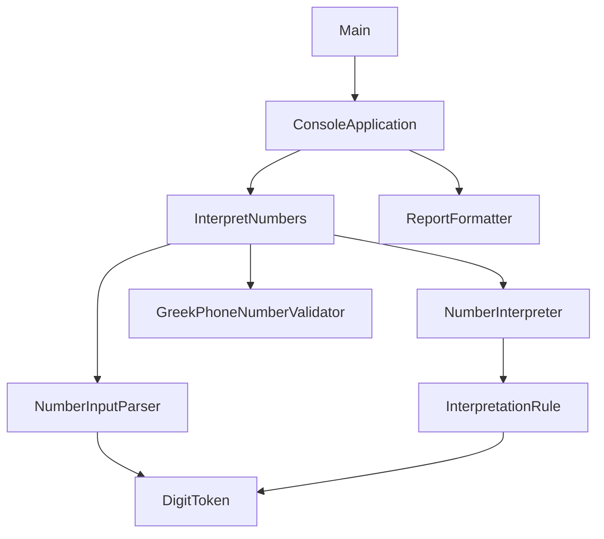

# Natural Numbers Interpretation

Standalone Java 21 console application for the Omilia programming assignment. It turns a sequence of recognized number groups into every distinct digit reading, then labels each reading against the Greek phone formats stated in the exercise.

## Requirements

- Java 21
- Apache Maven **3.6.3** or newer (3.9+ recommended)

No runtime libraries, network, or database. JUnit 5 is test-only. JaCoCo and the Maven Enforcer plugin run at build time.

## Build, test, and run

Run the full suite at once:

```bash
mvn test
```

That compiles production and test sources and executes every JUnit 5 class under `src/test/java`.

For the complete gate used before submission (clean rebuild, lint, all tests, jar, JaCoCo and JavaDoc):

```bash
mvn clean verify
java -jar target/natural-numbers-interpreter-1.0.0.jar
```

Type space-separated groups of 1–3 digits. `exit` (any case, surrounding whitespace ignored) or end of stream stops the loop. Program arguments are ignored.

`mvn clean verify` compiles with `-Xlint:all` and fails on warnings, runs the same tests as `mvn test`, packages the jar, writes coverage to `target/site/jacoco/index.html`, and generates API docs under `target/reports/apidocs/`.

### JavaDoc

Production sources are documented with JavaDoc (packages, types and public/package members). Generate and browse them with:

```bash
mvn javadoc:javadoc
```

Open the index page:

- Linux/macOS: `target/reports/apidocs/index.html`
- Windows: `target\reports\apidocs\index.html`

```bash
# examples
xdg-open target/reports/apidocs/index.html          # Linux
open target/reports/apidocs/index.html              # macOS
start target\reports\apidocs\index.html             # Windows PowerShell / cmd
```

`mvn clean verify` also regenerates the same site. The plugin runs with `doclint=all` and fails the build on JavaDoc warnings.

On a machine without Maven, compile every file under `src/main/java` and run `com.omilia.numbers.Main`:

```bash
find src/main/java -name '*.java' > sources.txt
javac --release 21 -d out @sources.txt
java -cp out com.omilia.numbers.Main
```

### Example

What you type is shown after `Input:`.

```text
Input: 2 10 69 30 6 6 4
Interpretations (4):
#      Output                 Phone number
1      2106930664             VALID
2      210693664              INVALID
3      21060930664            INVALID
4      2106093664             VALID
```

| Input | Readings, in program order | Phone labels |
| --- | --- | --- |
| `20 5` | `205`, `25` | both invalid |
| `75` | `75`, `705` | both invalid |
| `2 10 6 9 30 6 6 4` | `2106930664`, `210693664` | valid, invalid |
| `2 10 69 30 6 6 4` | `2106930664`, `210693664`, `21060930664`, `2106093664` | valid, invalid, invalid, valid |
| `0 0 30 69 700 24 1 3 50 2` | 12 readings; the literal join is first | `00306972413502` is valid |

Reading 1 is always the literal concatenation of the original groups. The order is stable and is not an attempt to copy the table order of the PDF.

## Rules

Each rule consumes one, two, or three **original** groups. Digits created by a rule are appended as text and are never split into new groups. `75 5` is `755` and `7055`. It does not become a fresh tens-plus-units problem.

### Required by the examples

1. **Literal.** Every group is kept as recognized. `30 6` can be `306`. Leading zeroes stay: `09` stays `09`, `0 0` stays `00`.
2. **Compound tens.** A canonical number from 21 to 99 whose units digit is not zero can also be read as tens plus units: `69` → `609`, `75` → `705`.
3. **Tens plus units.** A canonical multiple of ten from 20 to 90, followed by 1–9, can be added: `30 6` → `36`, `20 5` → `25`.
4. **Hundreds plus what follows.** A canonical multiple of 100 from 100 to 900 combines with a following canonical 1–99 (`700 24` → `724`) and, when the next two groups are tens and units, with both (`700 20 5` → `725`).

### Inferred, and tested

- **11–19 are not compound tens.** "Eleven" is not "ten one". `11` stays `11`.
- **10 is not a tens word.** `10 6` stays `106`.
- **A remainder is any canonical 1–99**, so `700 6` is also `706`. The examples show `24` and `20`, which sit in that range; the code does not special-case them.
- **A non-canonical spelling is literal only.** `09`, `00`, `024`, and `06` are not spoken quantities. `30 06` stays `3006`. `700 024` stays `700024`.
- **Same digits, one row.** Two derivations of the same string are emitted once, the first time the depth-first search finds them.
- **A reading is never dropped because it is not a phone number.**

### Phone formats

These are the exercise rules, not a full Greek numbering plan.

| Length | Prefix | Result |
| --- | --- | --- |
| 10 | `2` or `69` | `VALID` |
| 14 | `00302` or `003069` | `VALID` |
| anything else, including null or non-digits | | `INVALID` |

`003069…` does not start with `00302`. Both prefixes are required. Length is checked as well: a 10-digit string that merely contains `00302` is invalid.

## Design

```text
com.omilia.numbers                 Main, the composition root
com.omilia.numbers.domain          DigitToken, RecognizedSequence, InvalidInputException
com.omilia.numbers.parsing         NumberInputParser
com.omilia.numbers.interpretation  NumberInterpreter and the closed rule set
com.omilia.numbers.phone           GreekPhoneNumberValidator, PhoneValidity
com.omilia.numbers.application     InterpretNumbers and the outcome types
com.omilia.numbers.cli             ConsoleApplication, ReportFormatter
```



| Type | Responsibility |
| --- | --- |
| `DigitToken` | One group of 1–3 digits. `text()` keeps the spelling; `value()` is only the numeric reading. Grammatical roles apply to canonical spellings. |
| `RecognizedSequence` | Non-empty immutable row. The interpreter does not parse again. |
| `InterpretationRule` | Package-private enum. Declaration order is the search order. |
| `NumberInterpreter` | Depth-first search. `LinkedHashSet` keeps the first occurrence of each string. |
| `GreekPhoneNumberValidator` | Total function from digits to `VALID` or `INVALID`. It does not throw for a bad number. |
| `InterpretNumbers` | Parse, interpret, annotate. Returns a sealed `InterpretationOutcome`. |
| `ConsoleApplication` | Prompts, prints, stops on `exit` or EOF. |
| `ReportFormatter` | The aligned text block. |
| `Main` | Wires the concrete objects and owns `System.in`, `System.out`, and `System.exit`. |

There is no interface with a single implementation. The use case takes the real parser, interpreter, and validator in its constructor. Tests call those objects directly.

### Errors

| Situation | What the caller gets |
| --- | --- |
| Null, blank, or a group that is not 1–3 digits | `RejectedInput` at the use case. The parser throws `InvalidInputException`; the CLI prints `Invalid input: …` and keeps reading. |
| A reading that is not a Greek phone number | The reading, marked `INVALID`. |
| No reading | Does not occur for a sequence that parsed: the literal rule always applies. |
| Cannot read standard input | `IOException`. `Main` prints `Could not read input: …` to stderr and exits with status 1. |
| Broken rule or broken token | `IllegalArgumentException` or `IllegalStateException`. That is a defect, not user input. |

### Complexity

Let *n* be the number of groups and *R* the number of distinct readings. A position admits at most three rules: the literal reading, and up to two combinations. A group is never both compound tens and hundreds. Time and memory follow the size of the text that has to be emitted, and that size grows exponentially with the number of ambiguous groups. Ten independent compound tens produce 1024 readings; the test locks that count.

The call stack grows with *n*. That fits a spoken phone number and will not fit thousands of groups. There is no silent cutoff and no filter by phone length: the assignment asks for every reading.

Suffix memoization was rejected. Ambiguous groups meet again at the next original token, so a depth-first walk with one shared `StringBuilder` is already proportional to the output. Caching each suffix and concatenating it onto every ancestor would copy those strings again and retain every intermediate set, without producing a reading the search does not already emit.

### Testing

JUnit 5. The suite locks:

- **`AssignmentExamplesTest`**: every input/output/phone label printed in the assignment PDF (base table, ambiguity prose, advanced examples 1–3, and the three sample sequences from the task statement)
- the full ordered list of 12 readings for `0 0 30 69 700 24 1 3 50 2`
- each rule in isolation, and a search driven by a subset of the rules
- leading zeroes, teens, `10 6`, and digits that must not be re-tokenized (`2 69`, `75 5`)
- phone prefixes and both lengths, including numbers that are valid and invalid in the same report
- blank lines, bad tokens, a console session that continues after an error, and `Main.main` / `Main.launch`

A fixed-seed check builds 40 short mixtures and asserts uniqueness, stability, digit-only output, and that the literal join is first. Run `mvn clean verify` for the current JaCoCo report under `target/site/jacoco/index.html`.

## Assumptions

Review these before treating the grammar as the only possible reading of the statement.

1. Groups are already separated by whitespace. The program does not find number words inside a longer digit string such as `2336`.
2. Eleven through nineteen are atomic. Ten does not combine with a following unit.
3. Hundreds combine with any canonical remainder from 1 to 99, not only with the samples `24` and `20`.
4. Output order is depth-first by rule declaration, not the PDF's table order.
5. The phone check is exactly the two lengths and four prefixes above.
